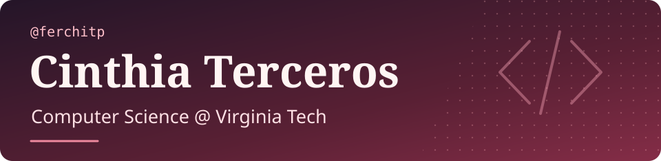

<p align="center">
  <code>▸ building mobile apps and exploring how to evaluate AI</code>
</p>

<p align="center">
  <a href="https://ferchitp.github.io/">Portfolio ↗</a> ·
  <a href="https://www.linkedin.com/in/cinthia-terceros26/">LinkedIn ↗</a>
</p>

<p align="center">
  
  
</p>

## 👋 About me

```python
ferchi = {
    "studying": "Computer Science + Mathematics minor at Virginia Tech",
    "building": ["mobile apps", "full-stack tools", "applied AI projects"],
    "curious_about": "How does AI performance change when the data changes?",
    "languages": ["Spanish", "English"],
}
```

<details>
<summary>🌱 How I got here</summary>

I started studying computer science at Northern Virginia Community College and continued at Virginia Tech. Building apps at hackathons got me interested in what happens after you add an AI feature. In one course project, I used BERT to classify hyperpartisan headlines and evaluated its performance across different time periods.

</details>

## 💼 Experience

| Role | What I do |
| --- | --- |
| **Student Office Assistant · Virginia Tech CS** | Support the Graduate Programs Office and help students connect with department resources. |
| **Events Chair · Association for Women in Computing** | Coordinate technical, professional development, and community events for computing students. |

## 🛠️ Selected projects

<table>
<tr>
<td width="50%" valign="top">
<h3><a href="https://github.com/ferchitp/homecrew">HomeCrew</a></h3>
<p>Helped build a multimodal AI app that helps renters document maintenance issues and prepare repair requests. Our team placed third at a Virginia Tech Google Developer Groups hackathon.</p>
<p><code>Next.js</code> <code>FastAPI</code> <code>Gemma</code> <code>Firestore</code></p>
</td>
<td width="50%" valign="top">
<h3><a href="https://github.com/ferchitp/HokieAssist">HokieAssist</a></h3>
<p>Led frontend development for a campus accessibility app that surfaces route details like stairs, elevators, and slope.</p>
<p><code>React Native</code> <code>Expo</code> <code>TypeScript</code></p>
</td>
</tr>
<tr>
<td width="50%" valign="top">
<h3><a href="https://github.com/ferchitp/JCM">CalcGuard</a></h3>
<p>Built full-stack features for a personal safety app and wrote 50+ Jest tests.</p>
<p><code>React Native</code> <code>Firebase</code> <code>Jest</code></p>
</td>
<td width="50%" valign="top">
<h3><a href="https://ferchitp.github.io/">Personal portfolio</a></h3>
<p>My project showcase and technical experience in one place.</p>
<p><code>HTML</code> <code>CSS</code> <code>JavaScript</code></p>
</td>
</tr>
</table>
